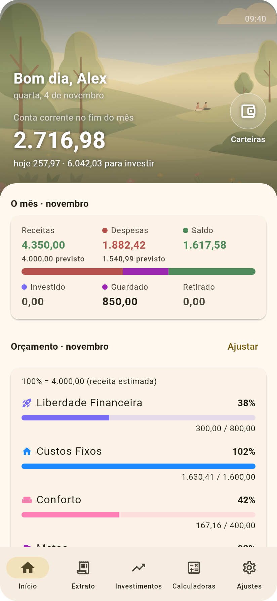
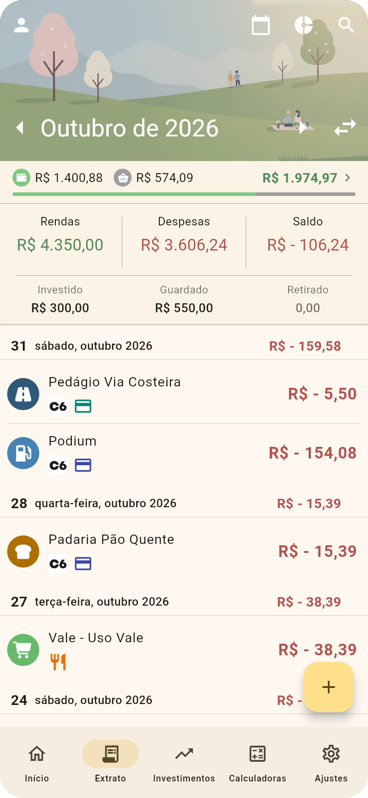
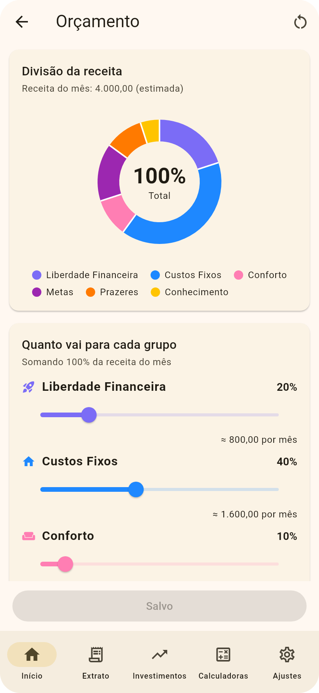
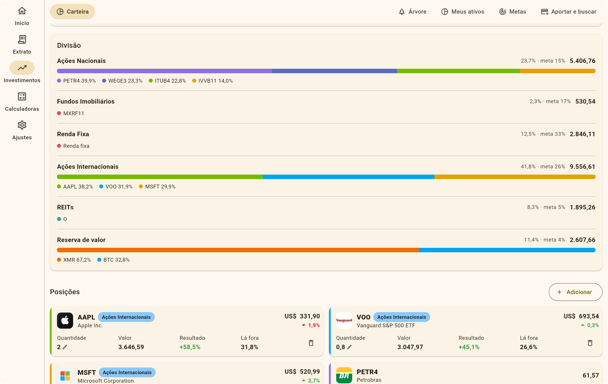
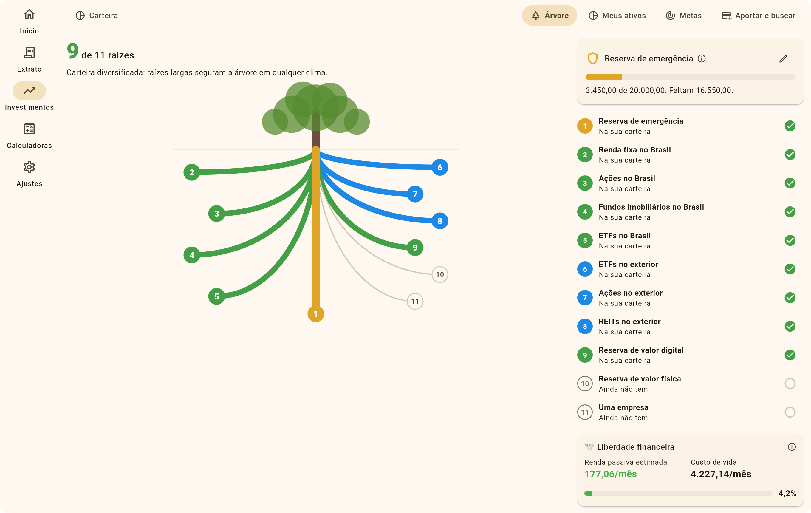
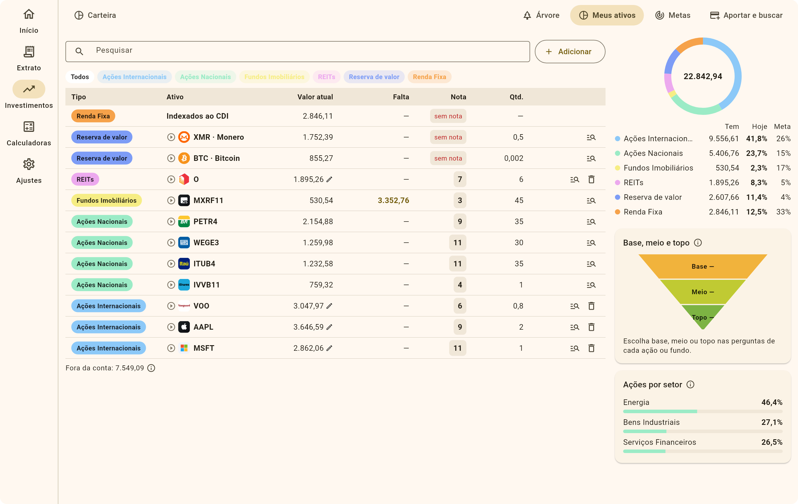
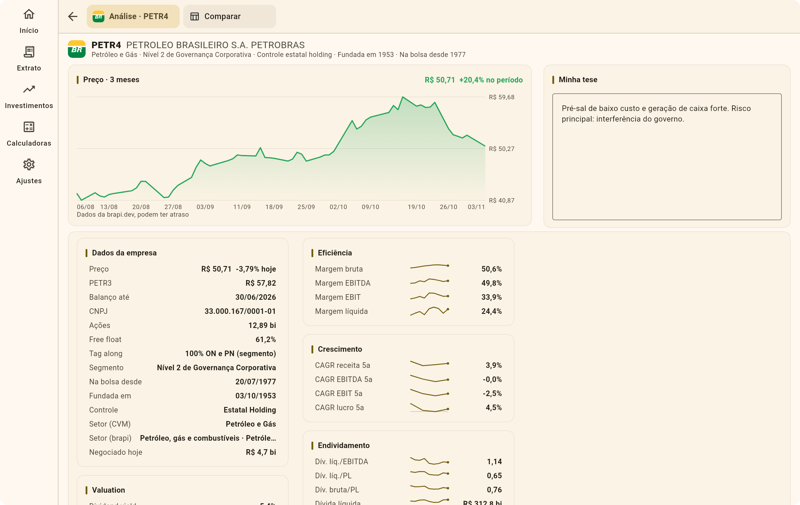

<div align="center">


# AUPP

**A Única Planilha Possível**

Finanças pessoais do gasto do dia ao próximo aporte, no Android e no Linux.


<br>

&nbsp;
&nbsp;


<sub>Prints do modo demonstração, com dados inventados.</sub>

</div>

> [!NOTE]
> Gratuito e sem vínculo com a AUVP, a Dinzo ou qualquer banco. Nada aqui é recomendação de investimento.

## O que faz

- **Extrato automático** dos bancos pela Dinzo (Open Finance), ou só lançamentos manuais.
- **Compra feita é dinheiro que saiu:** 12x de R$ 100 contam R$ 1.200 no dia da compra.
- **Orçamento** pela divisão da receita, com estimativas das contas que ainda vêm.
- **Contas a pagar** com Pix e boleto: cola ou escaneia o código e o app avisa no vencimento.
- **Carteiras virtuais** dizem para que serve cada real, em qualquer banco.
- **Investimentos** da B3, do exterior e de cripto numa carteira só, comparados à Selic, com metas por classe e onde pôr o próximo aporte.
- **Impostos da empresa** (Simples Nacional e MEI): notas, pró-labore e Fator R mês a mês.
- **Análise de empresas** no computador: balanços, indicadores e comparação.
- **Celular e computador em sincronia** por um arquivo criptografado (AES-256-GCM) trocado pelo Syncthing. Sem servidor próprio e sem anúncios.

## No computador

| Carteira | Árvore |
|---|---|
|  |  |

| Meus ativos | Análise |
|---|---|
|  |  |

## Integrações

Só por API, nunca lendo sites. Cada chamada está em [docs/APIS.md](docs/APIS.md).

| Serviço | Para quê | Chave |
|---|---|---|
| [Dinzo](https://dinzo.com.br/docs) | Contas, cartões, lançamentos e investimentos dos bancos (Open Finance) | Opcional |
| [brapi.dev](https://brapi.dev/docs) | Cotações da B3 e de outras bolsas | Sim |
| [CVM](https://dados.cvm.gov.br) | Balanços das empresas brasileiras | Não |
| [SEC (EDGAR)](https://www.sec.gov/search-filings/edgar-application-programming-interfaces) | Empresas e balanços dos EUA | Não |
| [OpenFIGI](https://www.openfigi.com/api) | Busca de ativos em outras bolsas | Não |
| [Banco Central](https://dadosabertos.bcb.gov.br) | Selic, CDI, IPCA, câmbio e dados dos bancos | Não |
| [CoinGecko](https://docs.coingecko.com), [Kraken](https://docs.kraken.com/api/), [mempool.space](https://mempool.space/docs/api/rest) | Cripto e o halving do Bitcoin | Não |
| API Pix do recebedor | Valor e vencimento de um Pix de cobrança | Não |

As chaves ficam no aparelho, fora dos backups e da sincronia.

## Compilar

Com o [Flutter](https://docs.flutter.dev/get-started/install):

```sh
flutter pub get
flutter build apk --release    # Android (sem chave própria, assina com a de debug)
flutter build linux --release  # Linux (precisa do webkit2gtk-4.1)
```

## Sobre

O nome brinca com "A Única Verdade Possível", da [AUVP](https://www.auvp.com.br), cujas aulas inspiraram a forma como o app trata dinheiro e investimentos. A tela Carteira e aporte reimagina o Diagrama do Cerrado com perguntas e cálculo próprios, e pode dar resultados diferentes da ferramenta oficial.

Derivado do [Oinkoin](https://github.com/emavgl/oinkoin), de [Emanuele Viglianisi](https://github.com/emavgl) e comunidade. Licença [GNU GPLv3](LICENSE), a mesma do original. Marcas e logos pertencem aos seus donos.
